# Phase A — Hand-painted look development

Generated 22 November 2026 with the built-in image_gen tool. **Gate A approved by the user
on 22 November 2026; this direction is locked for the next art pass.** This pack covers the two style frames, three character sheets,
and six level palette/lighting keys requested in `docs/design/ART_DIRECTION.md`.

## Recommended style frames

| Frame | Review image | Native original |
|---|---|---|
| Oak Road | [1920×1080](oak-road-style-1920x1080.png) | [v2](oak-road-style-v2.png) |
| Druid's Trial | [1920×1080](druids-trial-style-1920x1080.png) | [v1](druids-trial-style-v1.png) |

The native generated frames are 1672×941. The 1920×1080 files are resampled presentation
exports, not additional detail or 4K production artwork. All originals are preserved.

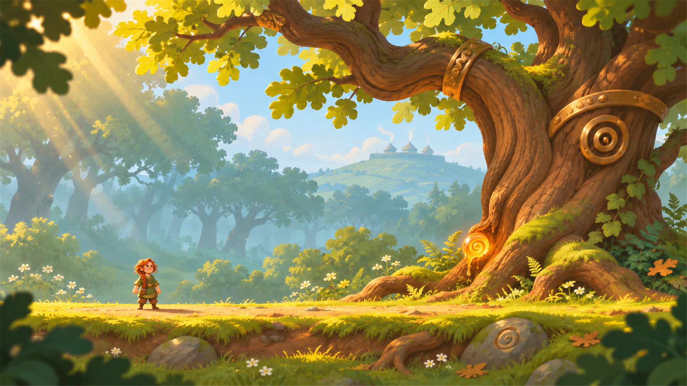

Oak Road proposes a gold-lit grassy playfield, cool woodland and hill bands, soft foreground
framing, a red-braided hero and an amber spiral sap knot. The v2 edit brings Brenna closer
to the planned gameplay scale and lowers the sap knot. The first oversized-hero exploration
remains in [v1](oak-road-style-v1.png) for provenance.

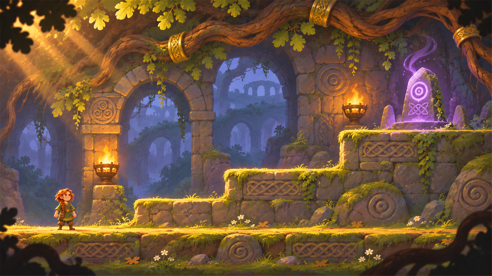

The Trial proposes bright platform lips against quieter blue-violet arches, amber torch
pools, and purple reserved for the shrine. These are composed style frames: their depth
bands have not been separated into seamless parallax assets, and their geometry is illustrative.

## Character concepts

| Character | Sheet | Contents |
|---|---|---|
| Brenna | [v1](brenna-concepts-v1.png) | Front/side/back, determined/delighted/worried expressions, sling pose |
| Legionary | [v1](legionary-concepts-v1.png) | Front/side/back, alert/dizzy/sheepish expressions, patrol and impact poses |
| Boar | [v2](boar-concepts-v2.png) | Front/side/back, three expressions, two gallop poses, corrected four-leg tumble |

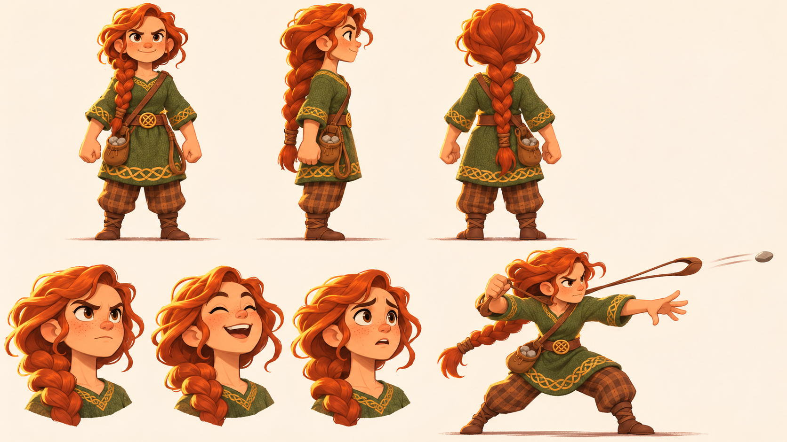

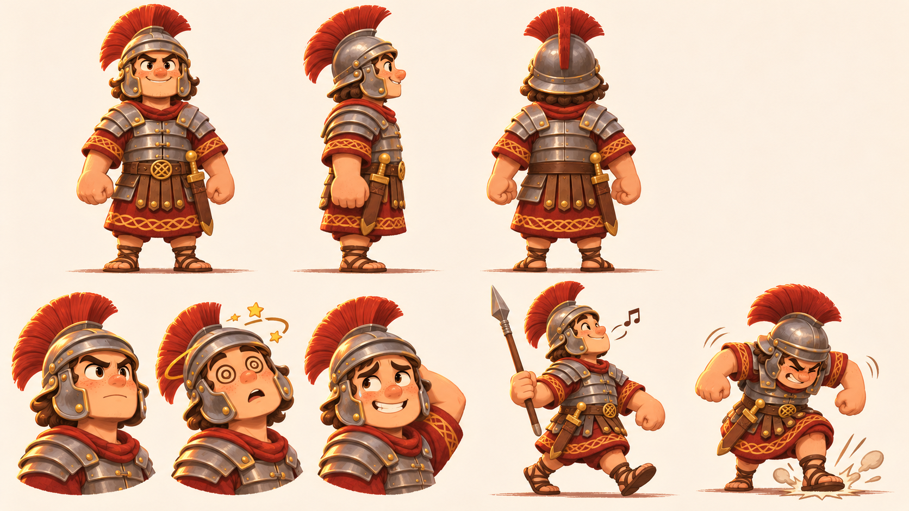

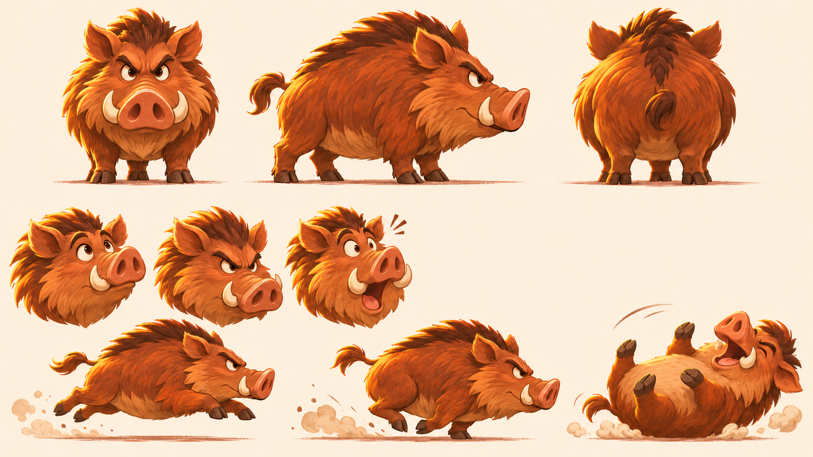

These are flattened concept sheets for design review, not layered PSB files or rig-ready
body parts. Before rigging, simplify dense costume trim, standardise pouch/braid placement
and silhouette proportions, and distinguish Roman geometric decoration from Celtic knotwork.
The legionary impact pose is a pose study rather than a final flattened stomp animation.

## Level palettes and lighting

The hex values below are proposed art-direction anchors supplied in the prompts, not exact
samples from generated brush swatches. Each linked board contains a scene study and six swatches.
Level themes follow `docs/design/LEVELS.md`.

| Level | Board | Palette anchors | Lighting role |
|---|---|---|---|
| The Oak Road | [Key 01](lighting-key-01-oak-road-v1.png) | `#243D33 #547442 #97B54B #C69350 #F4C665 #A7C3CA` | Warm top-left canopy light; cool depth; amber sap focal point |
| The River Crossing | [Key 02](lighting-key-02-river-crossing-v1.png) | `#243E50 #40758A #76B6C5 #DDE9DF #8B7651 #D9B563` | Cool mist and whitewater; warm hero rim; bright branch path |
| The Night Marsh | [Key 03](lighting-key-03-night-marsh-v1.png) | `#201D32 #39324D #645273 #8F91AE #D4E593 #E6AE62` | Purple fog; firefly navigation accents; local gold search cones |
| The Roman Camp | [Key 04](lighting-key-04-roman-camp-v1.png) | `#302B31 #654235 #9C5040 #B98252 #E6B564 #7C9099` | Red-brown timber and cloth; torch pools; cool distant camp |
| The Iron Mines | [Key 05](lighting-key-05-iron-mines-v1.png) | `#211F25 #42434A #72757D #B95A32 #F59C3B #FFE0A1` | Quiet charcoal recesses; hot iron accents; cool tunnel depth |
| Fort Varro | [Key 06](lighting-key-06-fort-varro-v1.png) | `#29333F #4C6173 #8195A4 #BAC8CB #F0E9CC #C69858` | Cool storm ambience; lightning separation; small warm interaction accents |

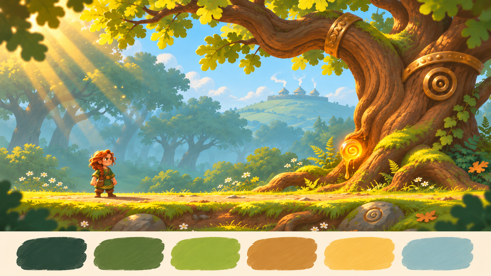
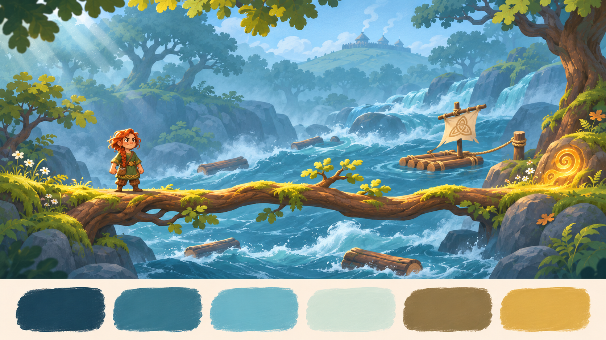
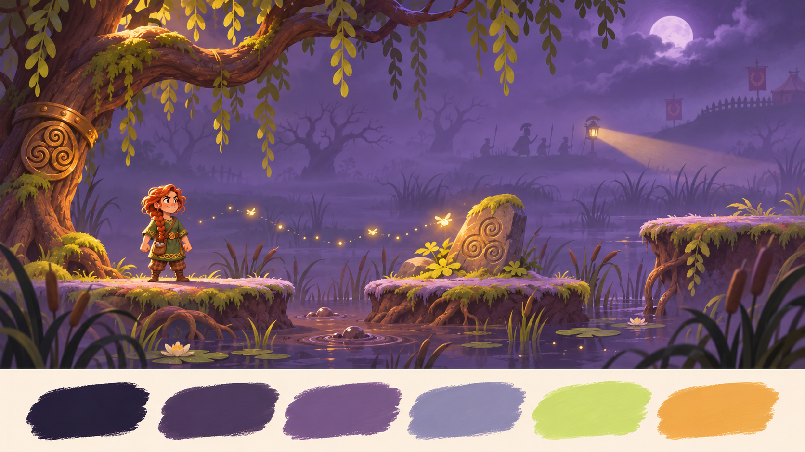
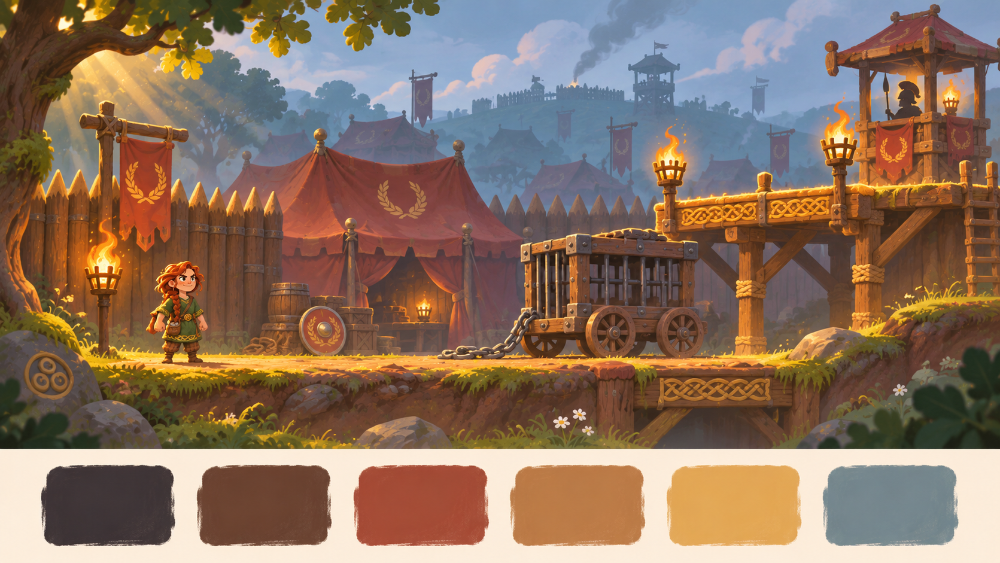
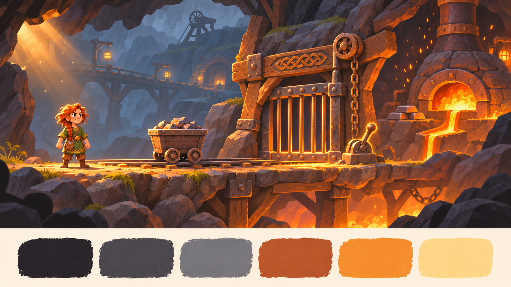
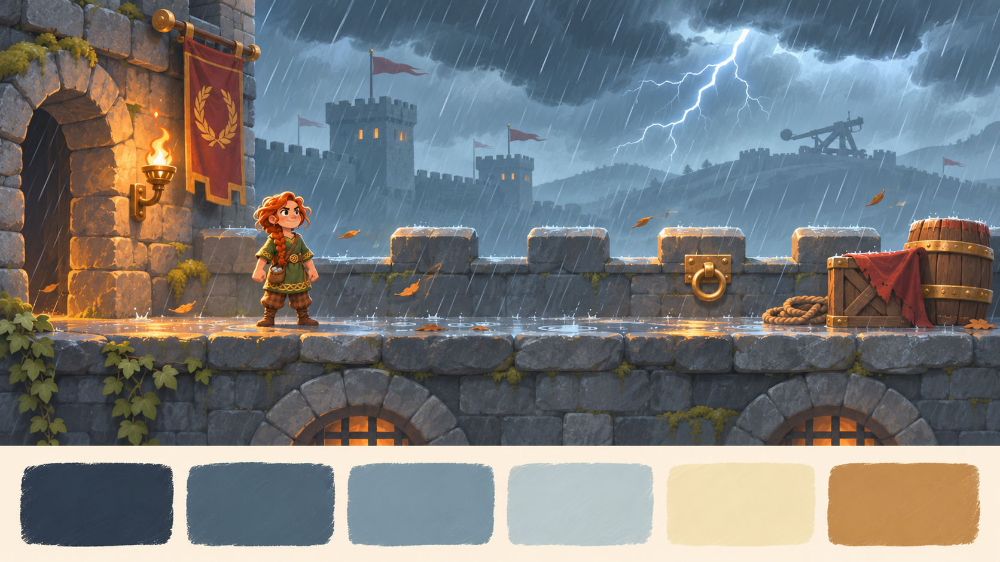

## Gate A review

Decide whether to lock the painted material treatment, chunky character proportions, Oak Road
depth/value hierarchy, amber sap and purple shrine language, and the six level palette families.
The two style frames are the recommended primary references; the color keys explore atmosphere
and are not camera-scale or geometry specifications. Give any revisions by filename.

Later implementation should test these visual choices in motion: background detail may need
reducing, the purple Trial could be darker, and hero/interactable separation needs an actual
gameplay check. Phase A does not establish animation quality, performance or seamless tiling.

Full prompts, reference paths, dates, native sizes, export operations and SHA-256 hashes are in
[generation.json](generation.json), also registered under `phaseA` in
[the project manifest](../../art-generation.json). Only original Ironoak images were supplied
as references. No runtime assets, rendering pipeline, gameplay, or M1 files were changed for
this pack. No commit was created.
