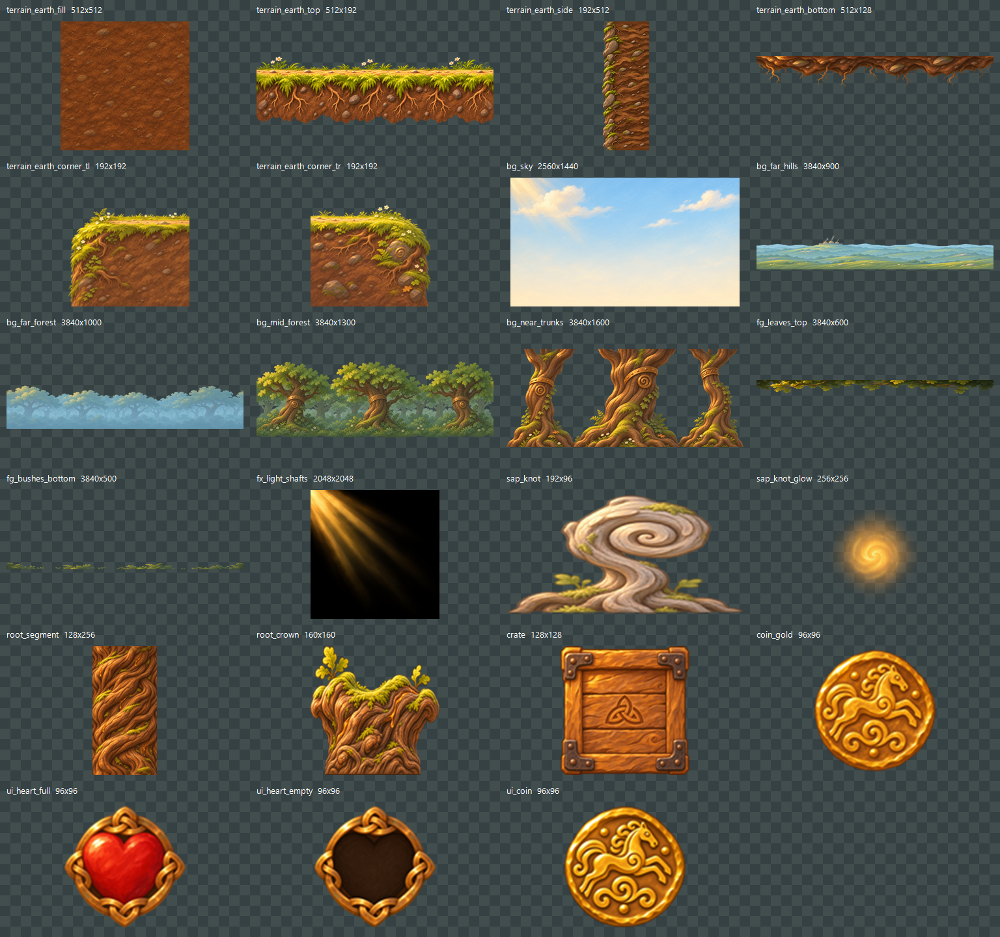

# POC Batch 1 — tech-spike art handoff

**Delivered 23 November 2026.** All 23 requested files are exported to their exact names and
canvas sizes under `Assets/_Ironoak/Resources/Art/Painted/`. The built-in image_gen tool
created the artwork, using only our approved original Ironoak references. This handoff is
for Claude's Batch 1 integration in `docs/art-requests/POC_ASSET_REQUESTS.md`.

| Destination under Painted | Count | Contents |
|---|---|---|
| `Environment/Forest/` | 14 | Earth fill, top/side/bottom strips, two corners; sky, hills, far/mid forest, near trunks, foreground leaves/bushes, light shafts |
| `Props/` | 6 | Neutral sap knot, separate amber glow, root segment/crown, crate, gold coin |
| `UI/` | 3 | Matching full/empty bronze-framed hearts and gold coin icon |

## Files and provenance

[generation.json](generation.json) records every prompt, reference, original output path,
selected iteration, native source dimensions, export dimensions, dates and hashes. It is
also registered in `docs/art-generation.json` under `pocBatches.batch1`. Source PNGs stay
here at native size. The four revised sources use `-v2-source.png`; the first drafts remain
available for provenance.

Re-export with `tools/prepare_poc_batch1.ps1` from PowerShell. Artwork changes were made with
image_gen. Export preparation trims standing-prop margins, resamples into the requested
canvases and reconciles narrow opposing-edge bands in premultiplied RGBA on the declared
repeat axes. These larger exports do not add detail beyond the generated source resolution.
The source files are preserved unchanged.

The top strip and both corner textures map their reference surface line to **64 pixels from
the top**. `sourceSurfaceY` in the manifest records the chosen source line. The sap knot is
pale bark so runtime tinting can control its state; the amber glow is a separate image.
The root segment and crown use organic bark, moss and sap after removing unintended metal
ornamentation. The empty heart was edited from the full heart to keep the frame consistent;
the HUD coin follows the collectible's horse-and-spiral design.

## Verification

[validation.json](validation.json) records the 23 file checks. All requested names, sizes and
RGBA files passed. Transparent artwork has clear alpha around its silhouette. Earth fill,
root segment, sky and the black-backed additive light-shaft overlay have solid coverage.
All **11 repeatable textures** have identical opposite boundary pixels on the requested
axes after edge reconciliation. Their [3×3 tiling previews](tiling-previews/) were visually
reviewed; unrequested repeat directions in a preview are not a tiling guarantee.

This is an asset handoff. URP rendering, Sprite Shape terrain, parallax placement, material
blending, prefab swaps and gameplay validation belong to Claude's integration step. The
previous 33/33 gameplay result is not a test of this new environment pack.

## Integration details

- The current painted importer caps textures at **2048** and clamps wrapping. Use a **4096**
  maximum texture size for the 3840-wide layers; choose Repeat on the axes listed in the manifest.
- Painted imports currently use centre pivots. Set standing props to **bottom-centre**;
  coins, glows and UI use **centre**, or apply equivalent anchor offsets in the consuming component.
- Use `fx_light_shafts.png` with additive blending: its background is intentionally black.
  The knot glow uses transparent alpha. Start at low overlay intensity.
- Keep background layers calm with their sorting, tint and lighting. Foreground leaves attach
  at the top; foreground bushes attach at the bottom. Their transparent space is intentional.
- `bg_far_hills.png` includes one village per texture. Repeating it repeats the village too;
  display one instance or separate the village at integration if it must appear only once
  across the whole level.
- Terrain corners and the root crown need overlap with their adjoining strips during assembly;
  review those joins in the Sprite Shape section before approving the integrated result.

No runtime code, level geometry, colliders or Brenna artwork changed in this batch. The
delivery is uncommitted. Batches 2–5 remain pending.
