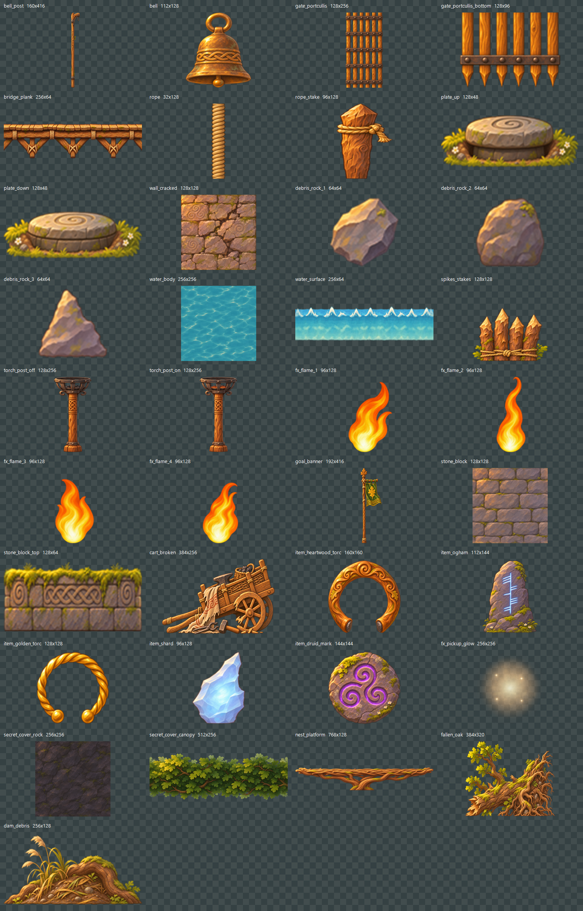

# POC Batch 2 — Level 1 puzzle art handoff

**Delivered 23 November 2026.** All **37 requested PNGs** are in
`Assets/_Ironoak/Resources/Art/Painted/Props/`, with the exact requested filenames and sizes.
The built-in image_gen tool created the artwork using only original Ironoak references.
Claude's prefab, material and gameplay integration is the next step.



The pack includes the bell/post, gate sections, bridge/rope/stake, pressure-plate states,
breakable wall and three chips, water body/surface, stakes, checkpoint torch states and four
flame frames, goal banner, masonry/top, broken cart, five pickups, pickup halo, two secret
covers, nest platform, fallen oak and dam debris.

## Provenance and exports

[generation.json](generation.json) records prompts, references, sources, selected revisions,
native dimensions, export crops/placements and SHA-256 hashes. All 37 first sources and seven
revised sources remain here at native size. The batch is also registered under
`pocBatches.batch2` in `docs/art-generation.json`.

Re-export from the repository root with:

```powershell
powershell -NoProfile -ExecutionPolicy Bypass -File tools/prepare_poc_batch1.ps1 -BatchName poc-batch-2
```

Image_gen made the artwork corrections. Export preparation trims transparent margins,
resamples into the requested canvases, aligns paired states and attachment points, and
reconciles narrow opposite-edge bands in premultiplied RGBA for repeatable textures.
The water body is exported at alpha 179/255 (70%). Stakes occupy the bottom 90 pixels.
No source PNGs were altered by export preparation.

## Integration notes

- Scale is **128 pixels per world unit**. Standing props use bottom-centre; pickups, debris
  and the pickup halo use centre; the bell uses top-centre. The bell-post foot and banner
  pole foot have been positioned at the canvas bottom-centre.
- The bell hook is near **(112, 374)** measured from the post canvas bottom-left, approximately
  **(0.70, 0.90)** normalized. Align the bell's top ring there and tune the swing visually.
- The tiled gate middle has six straight bars; finish it with the separate six-point bottom.
  Overlap the join slightly if needed when assembling the gate.
- Torch on/off share a crop. The four flames contain fire only, use a common scale and have
  their bases aligned at the bottom-centre. Place that anchor inside the brazier. The current
  importer gives all `fx_` sprites a **centre pivot**: override the flame pivot to **(0.5, 0)**,
  or offset the flame child upward by half its height (**0.5 world units**).
- Pressure-plate states share normalized framing; swap at the same transform and baseline.
- The water body already contains 70% alpha. Start with a white, fully opaque renderer tint
  and alpha blending so the material does not apply another 70% multiplier. Layer the foam
  strip at its surface. Use the pickup halo with the project's additive glow material.
- The current importer clamps these new prop textures. Set Repeat on the axes below if
  rendering with repeated UVs; repeated sprite instances do not require that setting.

| Repeat axes | Assets |
|---|---|
| Vertical | `gate_portcullis`, `rope`, `wall_cracked` |
| Horizontal | `bridge_plank`, `water_surface`, `stone_block_top`, `secret_cover_canopy` |
| Both | `water_body`, `stone_block`, `secret_cover_rock` |

## Verification and remaining work

[validation.json](validation.json) records all 37 filename, dimension and RGBA checks, alpha
coverage and exact opposing-edge comparisons for the ten repeatable textures. The contact
sheet and all ten [3×3 previews](tiling-previews/) were visually reviewed. Only the declared
axes are repeatable; the other directions shown in a preview are for inspection.

This delivery changes art and its export tooling/documentation. Runtime integration and
an in-game review of joins, flame animation, collision silhouettes and sorting remain for
Claude. No gameplay pass is claimed for these new assets. The batch is uncommitted;
Batches 3–5 remain pending.
